# flowmap

Maps how something works, connects or flows: a codebase, a system, a process, a decision or a document. Every box and arrow is traced to a source, such as a file and line, a URL, a doc section or "the user said". A claim with no source is drawn dashed and listed for you to confirm, so the map shows what it knows and what it guesses. Promises such as "nothing ships without review" are checked against every path, and a path that breaks one is drawn in red.

Skill: [`skills/design/flowmap/SKILL.md`](../../skills/design/flowmap/SKILL.md) · Model-invoked · MIT



*[`tests/fixtures/checkout/`](../../skills/design/flowmap/tests/fixtures/checkout/): a made-up shop with a bug. The rule "No receipt goes out unless the card is accepted" breaks: when the card network times out, the retry queue saves the order as pending and the receipt goes out anyway. Every step on the red path is cited to a line of [the shop's code](../../skills/design/flowmap/tests/fixtures/checkout/shop/). The one dashed arrow, "charges again later", is only a comment in that code, so it is drawn as a guess for you to confirm.*

## What it does

The agent does the judgment and a script does the mechanics.

1. **The agent** picks the reader and the one question the map answers. It reads the real material and writes a small JSON graph: boxes, arrows, groups, rules, and a `source` for each claim, with labels in the reader's words.
2. **The command** (`scripts/flowmap.mjs`) checks the graph before drawing it:
   - **Sources:** each cited file is there and each cited line is in range. A cited line that shares no word with its claim is a warning. This is a plausibility check: it catches a wrong path or a line number that has drifted, not a line that uses the same word to say something else, so the agent still reads each line it cites.
   - **Flow:** boxes nothing reaches, dead ends, one-way decisions and loops with no way out.
   - **Rules:** each promise is checked against every path. A broken rule comes with the shortest path that breaks it, drawn red, or orange when the path rests on a guess.
   - **Readability:** more than about 20 arrows, code names as labels, repeated labels, a box with no arrows, too many colors, or a drawing much wider than it is tall.
3. **The agent** looks at a picture of the layout, fixes crossings and collisions, and hands off: the question, each rule with ✓ or ✗, the dashed claims to confirm, what the map leaves out, and the page to open.

It writes one file, an HTML page. The diagram sits on a canvas you can zoom and pan, and a side panel shows the source of whatever you click, the rules, the claims to confirm, what the map leaves out, and a legend. A Flows list lets you pick one journey through the graph and step through it. The renderer, [Pele](https://pele.run), is inlined, so the page works offline (about 850 KB). On request it also keeps the SVG, a plain Mermaid file that shows on GitHub and in Obsidian, and the report.

[`tests/fixtures/flowmap/`](../../skills/design/flowmap/tests/fixtures/flowmap/) is the skill drawn by itself, cited to its own files.

## When to reach for it

- "How does checkout work?", "map this repo's build pipeline", "draw how these services talk to each other".
- You want a diagram someone can trust or check, not just a picture: each box links to the line that says it.
- You want to know whether a flow keeps a promise, such as "a failed payment never sends a receipt" or "nothing reaches production without review".
- Onboarding: a map of a system for someone new, with its limits written down.

Not for charts of numbers (use a charting tool) or for designing UI. For a quick sketch nobody will check, such as an idea to talk through, the agent writes a Mermaid block in its reply instead and offers a traced flowmap if you want one.

## Setup

Install the collection for your agent (see [Install](../../README.md#install)), or just this skill:

```bash
npx skills@latest add YLynnLee/lynn-skills --skill flowmap
```

It works with any agent that can run shell commands, such as Claude Code, Codex, Gemini CLI, Cursor or Copilot. Chat-only assistants that cannot run commands cannot use it.

| What | Needed for | Install |
|---|---|---|
| Node 20 or later | Everything | https://nodejs.org |
| Pele 1.13.0 | Rendering | Nothing to do: it ships in the skill's `vendor/pele/` |
| Chrome, Chromium or Edge, or Playwright | Optional: PNG previews the agent uses to check the layout | Chrome or Chromium is found by itself, and Edge on Windows (`$FLOWMAP_CHROME` names another). Or `npm install --prefix ~/.cache/flowmap playwright && npx --prefix ~/.cache/flowmap playwright install chromium` |

Inside the skill folder:

```bash
node scripts/doctor.mjs
```

`doctor.mjs` prints `OK` or `MISSING` for each one, with the fix. The skill runs it before its first run.

To run the command yourself:

```bash
node scripts/flowmap.mjs tests/fixtures/checkout/checkout.json --png
```

It writes `checkout.html` next to the input and prints the report. `--out DIR` writes the page somewhere else, `--all` also keeps the `.mmd`, `.svg`, `.report.md` and PNG, and `--help` lists every option. The graph format is in [`references/graph-format.md`](../../skills/design/flowmap/references/graph-format.md).

## Common questions

**Can it draw a sequence diagram, a state machine or an ER diagram?** Yes. The agent writes that diagram as Mermaid (`.mmd`) and the same command renders it. It can't check the sources of a `.mmd` file, so the agent gives you a table of where each part came from instead. See [`references/mermaid.md`](../../skills/design/flowmap/references/mermaid.md).

**Does a ✓ mean my system keeps the promise?** It means the map keeps it. Rules are checked against the boxes and arrows as drawn, so a rule that holds is only as true as the arrows, and dashed arrows are guesses until you confirm them.

**What happens when I confirm a dashed claim?** The agent sets its source to "user said", or to the line you point to, and renders again, so the claim is drawn solid.

**It says `No PNG`.** There's no Chrome, Chromium, Edge (on Windows) or Playwright to take the picture. The page still works; the agent opens it in a browser if it can, or tells you nobody has looked at the layout.

**My graph has 40 arrows.** Above about 20 the command warns. The agent merges boxes that act the same for the reader, or splits the map into an overview and a close-up, and lists what it dropped under "leaves out".

## It's working if

- Every solid box and arrow, when clicked, shows a source you can open and find the claim in.
- Everything the agent guessed is dashed and listed under "To confirm".
- The hand-off names each rule with ✓, ✗ or ?, and a ✗ comes with its path.
- The page says what the map leaves out.
- Arrows don't cross for no reason, and labels don't collide.

## Tests

From the skill folder:

```bash
npm test
```

There is nothing to install first. They render through the real Pele. They check the source, flow and rule checks against small graphs, the page and report, and that each graph in `tests/fixtures/` still checks clean and produces its committed `.mmd`; the checkout graph must find its planted bug. After you change the generator, check the new Mermaid and run `FLOWMAP_UPDATE=1 npm test` to rewrite it. The picture at the top of this page is `flowmap/checkout.svg`; to refresh it, run `node scripts/flowmap.mjs tests/fixtures/checkout/checkout.json --all --out <tmp dir>` and copy the SVG here. CI runs them on Linux, macOS and Windows with Node 20, 22 and 24 whenever the skill changes (`.github/workflows/flowmap.yml`).

Pele is copied from npm into `vendor/pele/`, so users need no `npm install`. To move to a new Pele version, run `npm run vendor -- 1.14.0`, then the tests. `npm run vendor:check` (also in CI) confirms the copy is byte for byte what npm publishes for that version.

## Credits

- [Pele](https://github.com/obsidianmd/pele) by kepano, MIT. It renders Mermaid to SVG.
- The approach comes from the [`statechart` skill](https://github.com/cursor/plugins/tree/main/pstack/skills/statechart) in Cursor's pstack: the agent writes the reader's words, a script does the checking and drawing, and the hand-off names what the chart leaves out.
